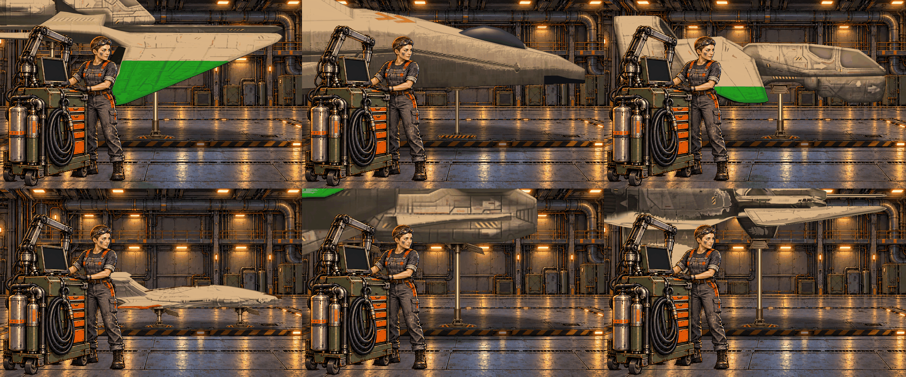

# Places: the carrier's rooms, built for the game

`tools/places.py` turns a room's painted layers into the game's 640x400
layers, puts the player's fighter in the room where it has one, and writes
a preview GIF of the room's script. data/places.json describes each room.
The painted sources (git-ignored) sit in `art/places/src/KEY/`; the built
layers (committed) go to `art/places/KEY/`.

    ~/.venvs/retrovega-art/bin/python -P tools/places.py [KEY ...] [--ship REDEEMR] [--still docs/deck.png]

The preview goes to `build/places/KEY.gif`. It uses one 256-colour palette
for the whole GIF, with no dithering, as the game will. `--rerender`
renders the fighters again; otherwise they are cached in
`build/places/ships/`.

## The launch deck



The deck is a side view of a hangar. Kit stands at her cart in front,
and the fighter sits on the pad behind her, nose right. Kit and her rig
come from an animation pack made for the scene (the user's image
synthesis; CC0): `background.png`, `foreground-base.png` (Kit and the
cart, full canvas, transparent elsewhere) and three clips. Each clip is an
atlas of 32 frames of one rectangle, the patch over her head and
shoulders, listed in `animations.json`:

| clip | what | frames |
|---|---|---|
| idle | breathing and blinking | 32 at 100 ms |
| console-work | gaze down, a small head dip, taps on the console | 32 at 80 ms |
| ready-nod | a double nod towards the fighter | 32 at 80 ms |

The source canvas is 1536x1024. It is cropped to 1536x960 (32 pixels off
the top and the bottom) and scaled to 640x400.

**Draw order:** the room, then the fighter's under layer (its shadow and
its reflection in the polished deck), then its landing legs, its exhaust, the
fighter itself, and last the front layer with the current frame's patch
copied in. The copy includes transparent pixels: the patch replaces that
rectangle of the front layer. The tool checks that no frame changes the
front outside the patch.

**The fighters** are rendered for the deck by `tools/shipviews.py`
(`--views E,H`), and the tool picks them up on its own:

- **Camera:** 10 degrees above, heading 270 (nose right).
- **Light:** a key from overhead, then warmed to the deck's lamps (`light`).
  Matching the room's light is what makes them sit in it.
- **Which ships:** every ship in data/ships.csv whose status starts with
  `player`. A new fighter needs only its row there and a re-run.
- **Size:** they share one scale, Vega Strike's own sizes: the mesh times
  the unit's `Unit_Scale` from units.csv, at `metre` source pixels a metre.

| ship | length | on the deck |
|---|---|---|
| Redeemer | 18 m | whole, 401 px long |
| Gawain | 26 m | whole, its tail behind Kit |
| Lancelot | 28 m | its top off the screen |
| Schroedinger | 30 m | its fins off the top |
| Pacifier | 38 m | the nose and the belly |
| Franklin | 41 m | the front two thirds, canopy dome and all |

**Placement:** the nose is at `nose_x`. The rest runs behind Kit and off
the left. A heavy fighter shows only its front and goes off the top.

**The landing legs:** every ship stands on two landing legs of one
style, chosen per ship (`legs` in data/places.json; `default` for the
rest).

| style | what | ships so far |
|---|---|---|
| `retract` | a gear leg, its door swung out towards the nose | the default: Redeemer, Schroedinger, Pacifier |
| `forwardretract` | a gear leg, its door folded across the front | Gawain, Lancelot |
| `sled` | a deck sled: a hazard-striped foot and a padded cradle | Franklin |

- **Art:** each style is a painted picture, `art/places/src/deck/legs/STYLE.png`
  (the user's image synthesis, side on, on white). The tool slices each
  one and scales it so its foot is 84 px wide.
- **Slicing:** the strut is the longest run of rows at its narrowest extent
  (the polished ram), the foot is everything below it, the saddle
  everything above. The engine stacks them, repeating the strut row to the
  height it needs (`leg-STYLE-foot/strut/saddle.png`). place.json gives
  each style's `axis` (the strut's middle) and `seat` (how far down the
  saddle the hull rests: the cradle's dip; 0 for the gear legs' flat
  plates).
- **Where they go:** on the body, never a wing. The tool finds each ship's
  body from its mesh: the triangles whose middles lie within 22% of the
  half-span of the centre line. Each leg goes to the place nearest its
  spot (`sleds`, source x: one mid-deck, one behind the cart, where it is
  mostly hidden; `more_sleds` adds spots for a ship, such as a nose leg
  for the small Redeemer) where the body covers the leg's whole top and nothing
  hangs lower. A leg behind a wing would look fixed to the wing. It may
  move up to 90 px for that. Its top meets the body's belly. Where a wing
  hangs below the body all along, as on the Schroedinger's front half, the
  leg still goes to the body and rises behind the wing. A leg that would
  end up within 60 px of the other is left out.
- **Size:** legs are full size under ships of 24 m and more; a shorter
  ship gets them smaller in proportion, down to 60% (the Redeemer, 18 m:
  74%, saved as `retract-62`, its foot 62 px wide).
- **Height:** every ship's lowest point clears its legs' shortest leg:
  the foot, the saddle and 4 rows of strut. On the gear legs that is about
  65 px, some 3 m.
- **Placeholder:** without any painted legs the tool draws one, `drawn`.

**The launch:** after the ready nod, the fighter launches and the legs
stay on the deck.

1. The engines spool up (600 ms).
2. It rises 4 px (400 ms).
3. It accelerates out to the right (900 ms), with the exhaust growing
   from the nozzles: the hull's last pixel at each engine's height.
   Vega Strike puts its engine lights inside the hull, so their own x is
   no use.

## place.json

Everything the engine needs, in screen pixels:

- **back** and **front**.
- **actor:** the patch rectangle, and each clip's atlas (8 frames to a
  row) and frame times.
- **fighter:** the deck's line, the leg styles' parts, and per ship:
  - **sprite:** the picture and its corner;
  - **under:** the under layer (RGBA: colour, and how much of it to blend
    over the room) and its corner;
  - **engines:** the nozzles, relative to the sprite;
  - **legs** (its style) and **sleds:** each leg's strut x and its top.
- **launch** timings.
- **script:** the order the clips and the launch play in.

## Painted leg prompt (the first, the cradle sled)

Send with the style block of [location-prompts.md](location-prompts.md):

```
A single piece of carrier deck equipment, isolated on a plain white background, seen
exactly side on at eye level: a heavy landing sled that holds a parked space fighter off
the deck. A low, wide steel foot with a yellow-and-black hazard band and two small amber
lights, standing flat; from its middle one thick polished hydraulic ram rising straight
up, the same width along its whole length; on top a padded saddle cradle, olive rubber in
a steel frame, slightly concave to take a hull. Worn gunmetal paint, ink linework, warm
amber hangar light from above. No fighter, no people, no shadow, no text.
```

## Still to do

- **Palette:** one for each room, shared with the faces and the fighter's
  colours.
- **The other rooms:** bar, bunks, locker, briefing and debrief, from
  [location-prompts.md](location-prompts.md).
